# Projektdokumentation – TokRecipe

> **Vor der Abgabe ergänzen:** Alle mit **[EIGENE ERGÄNZUNG]** markierten Stellen ausfüllen und diese Hinweise danach entfernen. Screenshots liegen unter `docs/screenshots/`; die unten aufgeführten Dateien werden direkt eingebunden. Noch fehlende Nachweisbilder sind als Empfehlung markiert. Testresultate, Modellnamen und getesteter Deployment-Stand müssen den tatsächlich gemachten Erfahrungen entsprechen.

## Projektübersicht & Zugänge

| Angabe | Inhalt |
|---|---|
| Projekttitel | TokRecipe – TikTok-Rezept-Manager |
| Verfasser/in | Jan Kollbrunner, BIS VZ B |
| GitHub-Repository | [jankollbrunner-ops/PR-Projektarbeit](https://github.com/jankollbrunner-ops/PR-Projektarbeit) |
| Aktuelle App | [TokRecipe auf Netlify](https://tokrecipe.netlify.app/) |
| Getestete Version | **[EIGENE ERGÄNZUNG: Netlify-Deploy-URL oder Deploy-ID und zugehöriger Commit/Tag; den tatsächlich getesteten Stand eintragen]** |
| Testzugänge | **[EIGENE ERGÄNZUNG: Testkonto/Bereitstellungsweg eintragen oder «Nicht erforderlich»; keine persönlichen Passwörter dokumentieren]** |
| Ursprüngliches Mockup (ohne KI) | [Rezept-Manager in Figma](https://www.figma.com/proto/8hAzFUaj6PIxLZ8Yh4tYLs/Rezept-Manager?node-id=0-1&t=3nkpRtnEPffGPvk9-1) |
| Überarbeitetes Mockup (Figma Make, KI) | [TokRecipe Recipe Manager](https://www.figma.com/make/Bx2pNObWdH60wCJHXJLxu2/TokRecipe-Recipe-Manager?fullscreen=1&t=nlKcPK5rSBOiUjvu-1) |
| Weitere Artefakte [Optional] | [PO Skizze.jpg](./docs/vorbereitungsaufgaben/PO%20Skizze.jpg), [PO crazy8.jpg](./docs/vorbereitungsaufgaben/PO%20crazy8.jpg), [Übung 9 Personas und User Journey.pdf](./docs/vorbereitungsaufgaben/%C3%9Cbung%209%20Personas%20und%20User%20Journey.pdf) |

> **Zugriff:** Stellt sicher, dass alle Dozierenden auf das Repository, die App und die verlinkten Artefakte zugreifen können.

> **Testzugänge:** Verwendet eigens eingerichtete Testkonten mit unkritischen Daten. Bei einem öffentlichen Repository gebt ihr hier nur den vereinbarten Bereitstellungsweg an. Persönliche Passwörter, API-Schlüssel und andere Geheimnisse dürfen nicht im Repository stehen.

<!-- Zentrale Projektlinks ausschliesslich in der Projektübersicht pflegen. Spezifische Nachweise wie Codestellen oder Testprotokolle direkt im jeweiligen Fachkapitel verlinken. -->

## Inhaltsverzeichnis

[Projektübersicht & Zugänge](#projektübersicht--zugänge)

1. [Ausgangslage](#1-ausgangslage)
2. [Lösungsidee](#2-lösungsidee)
3. [Vorgehen & Artefakte](#3-vorgehen--artefakte)
    1. [Understand & Define](#31-understand--define)
    2. [Sketch](#32-sketch)
    3. [Decide](#33-decide)
    4. [Prototype](#34-prototype)
    5. [Validate](#35-validate)
4. [Erweiterungen [Optional]](#4-erweiterungen-optional)
5. [Projektorganisation [Optional]](#5-projektorganisation-optional)
6. [KI-Deklaration](#6-ki-deklaration)
7. [Anhang [Optional]](#7-anhang-optional)

> **Hinweis:** Massgeblich sind die im **Unterricht** und auf **Moodle** kommunizierten Anforderungen.

<!-- Diese Vorlage ist für eine README.md im Repository gedacht. -->

<!-- WICHTIG: Reihenfolge, Nummerierung und Benennung der vorgegebenen Kapitel beibehalten. Als [Optional] gekennzeichnete Abschnitte dürfen entfallen, sofern in den Übungen nichts anderes verlangt wird. Ohne KI-Einsatz dürfen zudem die Unterkapitel 6.1–6.3 entfallen; die ausdrückliche Angabe dazu in Kap. 6 bleibt verpflichtend. Die in Kap. 4 vorgesehenen Einträge für einzelne Erweiterungen sind entsprechend zu ergänzen. -->

## 1. Ausgangslage
Kurz beschreiben, welches Problem adressiert wird und welches Ergebnis angestrebt ist. Wem nützt die Lösung, wer ist beteiligt oder betroffen?
- **Problem:** Gespeicherte TikTok-Kochvideos sind in App-Listen schwer wiederzufinden, beim Kochen oft zu schnell geschnitten und enthalten nicht immer klare Zutatenlisten oder Mengenangaben.
- **Ziele:** TikTok-Rezepte zentral speichern, nach Kategorien und Suchbegriffen wiederfinden und als strukturierte Schritt-für-Schritt-Anleitung nachkochen.
- **Primäre Zielgruppe:** Social-Media-affine Personen, insbesondere Studierende und WG-Köch:innen.

## 2. Lösungsidee
Beschreibt die Lösungsidee.
- **Kernfunktionalität:** Rezepte mit Zutaten, optionaler Zubereitung und TikTok-Link erfassen, auf dem Dashboard kategorisiert suchen, Details ansehen, bearbeiten und löschen. Nach dem Kochen können weitere Bewertungen abgegeben werden; angezeigt wird der Durchschnitt aller Bewertungen. Benutzer können sich mit einem eindeutigen Namen anmelden, Rezepte speichern und auf einer persönlichen Seite als bereits gekocht markieren.
- **Annahmen [Optional]:** Eine strukturierte, schnell durchsuchbare Rezeptsammlung erleichtert das Wiederfinden und Nachkochen gespeicherter Kurzvideos.
- **Abgrenzung [Optional]:** Einbindung anderer Videoplattformen, Eigene Video/Bilder. Automatisches Auslesen von Rezept und Zutaten aus Videobeschreibung von Tiktok.

## 3. Vorgehen & Artefakte
Die Durchführung erfolgt phasenbasiert; dokumentiert die wichtigsten Ergebnisse je Phase.

### 3.1 Understand & Define
- **Zielgruppenverständnis:** Die drei Proto-Personas konkretisieren unterschiedliche Nutzungssituationen: Lisa, die spontane Studentin, sucht abends schnelle Kochinspiration in ihrer WG; Kevin, der strukturierte Meal-Prepper, möchte Rezepte und Einkäufe planen; Sarah, die experimentierfreudige WG-Köchin, kocht für mehrere Personen und möchte eigene Anpassungen festhalten. Personas und User Journey sind in [Übung 9 Personas und User Journey.pdf](./docs/vorbereitungsaufgaben/%C3%9Cbung%209%20Personas%20und%20User%20Journey.pdf) dokumentiert.
- **Wesentliche Erkenntnisse:** Gespeicherte Videos sind in App-Listen schwer wiederzufinden, zum parallelen Kochen oft zu schnell und enthalten nicht immer genaue Zutaten oder Mengen. Die How-Might-We-Fragen fokussieren darauf, Video-Rezepte dauerhaft und strukturiert zu speichern und den Kochprozess mit ihnen stressfreier zu gestalten. Gewünscht sind ausserdem gut lesbare Mengen und Schritte, die beim Kochen ohne ständiges Pausieren nutzbar sind.

### 3.2 Sketch
- **Variantenüberblick:** In der Crazy 8 wurden mehrere Varianten für Dashboard, Rezeptübersicht und Detailansicht skizziert. Die Varianten sind in [PO crazy8.jpg](./docs/vorbereitungsaufgaben/PO%20crazy8.jpg) festgehalten.
- **Skizze:** Die anschliessende [PO Skizze.jpg](./docs/vorbereitungsaufgaben/PO%20Skizze.jpg) zeigt Wireframes für das kategorisierte Dashboard mit Rezeptkarten, die Rezept-Erfassung sowie Rezeptlisten und -details. Die Erfassung umfasst Name, Zutaten, Rezepttext und Link; die Detailansicht kombiniert Video, Zutaten und Kochanleitung.

### 3.3 Decide
- **Gewählte Variante & Begründung:** Das ursprüngliche Figma-Mockup wurde ohne KI erstellt. Danach wurde es mit Figma Make KI-unterstützt überarbeitet. Die überarbeitete Variante mit Navigation, Suche, kategorisierten Rezeptkarten und Zufallsrezept diente als Referenz für den Prototyp.
- **End-to-End-Ablauf:** Die User Journey Map beschreibt vier Phasen: TikTok-Rezept entdecken, Link und Rezeptangaben speichern, Rezepte in der Übersicht auswählen und beim Kochen die Detailansicht mit Video nutzen. Als Risiken sind unter anderem verlorene oder nicht auflösbare Links, eine unübersichtliche Sammlung und ein nicht verfügbares Video festgehalten.
- **Mockups:** Links zu beiden Versionen siehe [Projektübersicht](#projektübersicht--zugänge). Personas und User Journey Map sind in [Übung 9 Personas und User Journey.pdf](./docs/vorbereitungsaufgaben/%C3%9Cbung%209%20Personas%20und%20User%20Journey.pdf) dokumentiert.

### 3.4 Prototype

#### 3.4.1. Entwurf (Design)
Beschreibt die Gestaltung und Interaktion.
> **Hinweis:** Hier wird der **Prototyp** beschrieben, nicht das **Mockup**.
- **Informationsarchitektur:** Die gemeinsame Navigation enthält Home, Rezept hinzufügen, eine Rezeptsuche, eine Anmeldung über das Benutzersymbol sowie den Link «Meine gespeicherten Rezepte». Das Dashboard zeigt kategorisierte Rezeptkarten und ein Zufallsrezept; Erfassungsformular und Detailseite unterstützen das Speichern, Bearbeiten und Löschen. Angemeldete Benutzer verwalten ihre persönliche Liste auf einer eigenen Seite und können dort Rezepte als «Bereits gekocht» markieren.
- **User Interface Design:** Helles, warmes Dashboard mit korallroten Aktionen, salbeigrüner Hero-Fläche und TikTok-Player-Vorschauen in den Rezeptkarten. Die Detailseite bindet den Player ebenfalls ein und bietet einen externen TikTok-Link als Ausweichmöglichkeit. Das Login-/Registrierungsfenster öffnet sich beim Benutzersymbol, beim Zugriff auf die persönliche Liste und beim Speichern eines Rezepts; angemeldete Benutzer sehen dort nur ihren Benutzernamen und den Abmeldebutton.
- **Designentscheidungen:** Klare Typografie und sichtbare Aktionen unterstützen die spontane Nutzung. Zutaten, optionale schriftliche Kochschritte und optionale Portionenzahl sind getrennt und schnell erfassbar; wenn eine schriftliche Anleitung fehlt, hilft das eingebettete Video beim Nachkochen. Bewertungen können nach jedem erneuten Kochen ergänzt werden; Karten und Detailansicht zeigen den Durchschnitt sowie die Anzahl der Bewertungen. Registrierung und Anmeldung benötigen für den Prototyp keinen Passwortschutz, da sie nur für persönliche Listen dienen.
- **Screenshots des Prototyps:** Die Screenshots zeigen die wichtigsten Ansichten. Vor der Abgabe sicherstellen, dass sichtbare Benutzernamen und Rezeptdaten als Testdaten geeignet sind.

  **Dashboard** – Navigation, Kategorien, Rezeptkarten mit TikTok-Vorschauen und Zufallsrezept-Schaltfläche:
  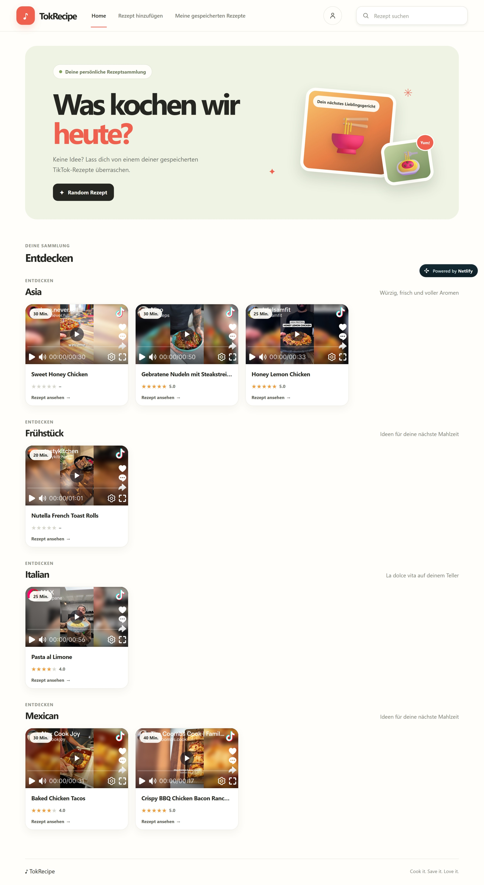

  **Rezept hinzufügen** – Erfassungsformular mit Pflichtfeldern und optionalen Angaben:
  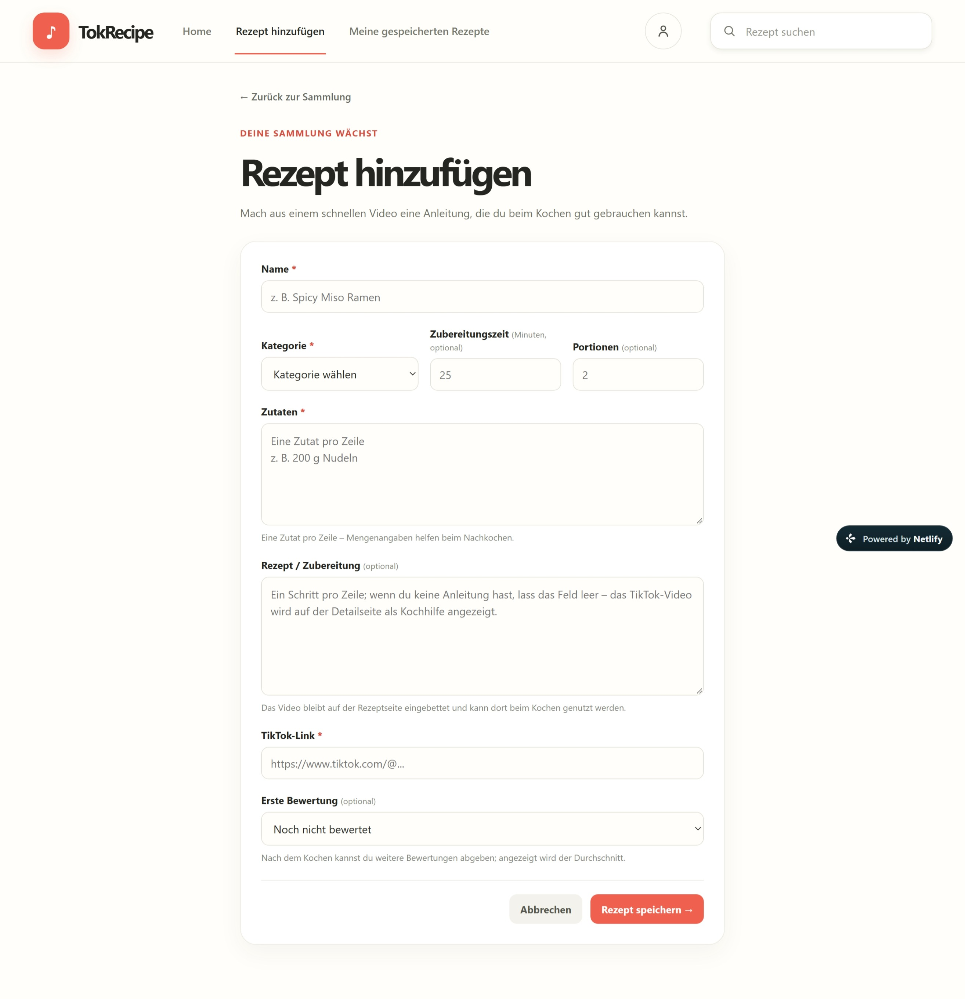

  **Rezeptdetail** – Zutaten, Zubereitung, Bewertung, gespeicherter Zustand und Originalvideo:
  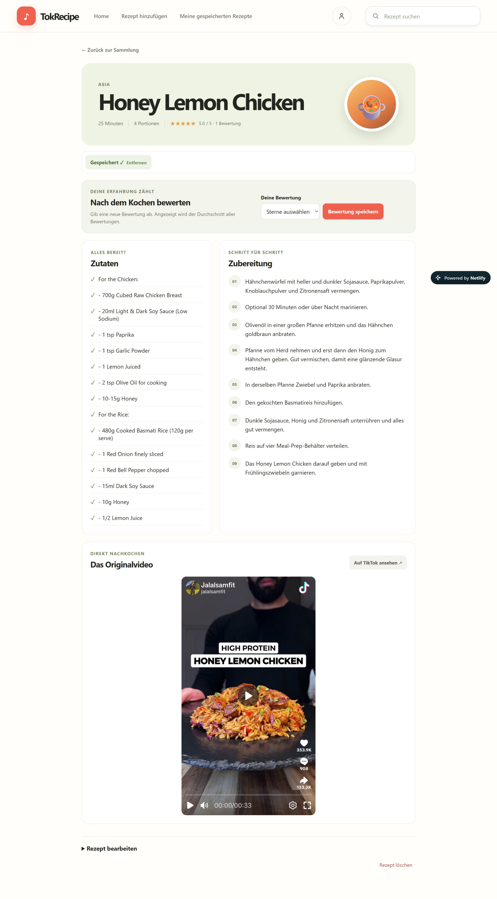

  **Rezept bearbeiten** – Geöffnetes Bearbeitungsformular auf der Detailseite:
  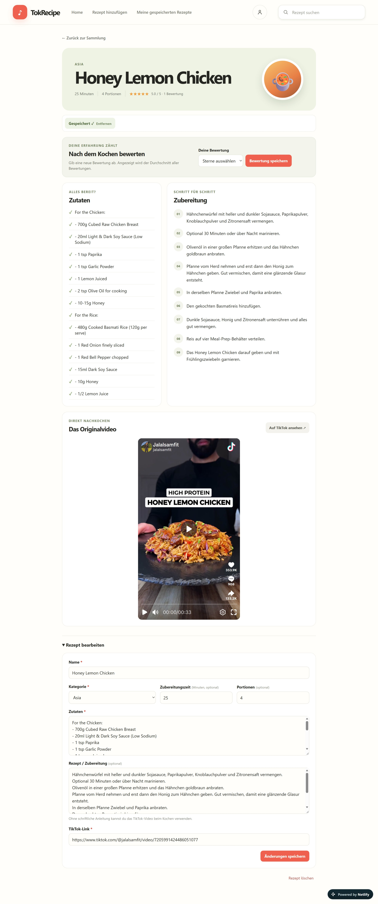

#### 3.4.2. Umsetzung (Technik)
Fasst die technische Realisierung zusammen.
- **Technologie-Stack (lokal installierte Versionen, Stand 26.11.2026):** SvelteKit 3.4.0, Svelte 5.58.0, Vite 8.3.8, `@sveltejs/adapter-netlify` 7.0.1, `@sveltejs/vite-plugin-svelte` 7.3.1, MongoDB Node.js Driver 6.22.0, Node.js 24.21.0 und npm 11.19.0. Die Versionen der JavaScript-Pakete stammen aus der installierten Projektumgebung; Node.js und npm sind die auf dem Entwicklungsrechner verwendeten Versionen.
- **Tooling:** Visual Studio Code, Git 2.56.0.windows.4, MongoDB Compass und MongoDB Atlas. KI-Unterstützung ist in Kap. 6 dokumentiert.
- **Vorgehen bei der Implementierung:** Iterative Umsetzung der Dashboard-Oberfläche, Formular- und Detail-Workflows sowie der serverseitigen MongoDB-Anbindung. Die Verbindung zu MongoDB Atlas wurde eingerichtet und vom Studierenden als funktionsfähig bestätigt. Das Löschen eines Rezepts erfordert ein serverseitig geprüftes Admin-Passwort aus `ADMIN_DELETE_PASSWORD`. TikTok-Videos werden über den offiziellen Embed Player eingebunden; für noch nicht auflösbare Kurzlinks wird die Video-ID über TikToks oEmbed-Schnittstelle ermittelt.
- **Struktur & Komponenten:** Die Anwendung und ihre Dateien liegen direkt im Repository-Stammverzeichnis. `src/routes/+page.svelte` und `+page.server.js` zeigen und suchen Rezepte. `/recipes/new` erfasst ein Rezept; `/recipes/[id]` zeigt, bearbeitet und löscht es. `src/lib/server/mongodb.js` kapselt den Datenbankzugriff; `recipe-form.js` validiert Formulareingaben. Das gemeinsame Layout und die Routenseiten sind Svelte-Komponenten.
- **Daten & Schnittstellen:** Rezepte werden serverseitig in der MongoDB-Datenbank `tokrecipe`, Collection `recipes`, gespeichert und von dort geladen. Einzelbewertungen werden als Liste gespeichert; der angezeigte Bewertungswert ist ihr Durchschnitt. Ältere Rezepte mit einer einzelnen Bewertung werden weiterhin unterstützt. Benutzer werden über eindeutige Benutzernamen in der Collection `users` verwaltet, Sitzungen werden in `sessions` gespeichert und persönliche Rezeptzuordnungen sowie deren Kochstatus in `savedRecipes`. Die Benutzeranmeldung ist für diesen Prototyp bewusst ohne Passwort umgesetzt. Die Verbindungsdaten liegen lokal in `.env` und werden nicht versioniert. Die Datenbank und Collections entstehen mit den ersten gespeicherten Daten.
- **Deployment:** Die App ist auf Netlify veröffentlicht; Link siehe «Aktuelle App» in der [Projektübersicht](#projektübersicht--zugänge). **[EIGENE ERGÄNZUNG: den auf Netlify tatsächlich getesteten Deploy/Commit dokumentieren.]**
- **Besondere Entscheidungen:** Der Prototyp trennt den verbindlichen Rezeptmanager vom optionalen Benutzersystem: Rezepte können auch ohne Anmeldung angesehen und erstellt werden. Die personalisierten Funktionen werden zusätzlich in Kapitel 4.1 dokumentiert.
- **Erfüllung des Mindestumfangs:** Abgedeckt sind ein funktionsfähiges SvelteKit-Dashboard mit Suche und Kategorien, die Erfassung eines Rezepts mit Zutaten und Link, die Detailansicht, das Bearbeiten und Löschen sowie die funktionsfähige MongoDB-Anbindung. SvelteKit-Routing und serverseitige Form Actions bilden die interaktive Anwendung; Eingabevalidierung, Fehlermeldungen und Erfolgsfeedback sind vorhanden. Die Oberfläche ist für Desktop und kleinere Bildschirmgrössen responsiv umgesetzt. Die App ist unter [tokrecipe.netlify.app](https://tokrecipe.netlify.app/) veröffentlicht. Ende-zu-Ende-Tests werden fortlaufend durchgeführt; Testresultate und allfällige Usability-Nachweise sind für die finale Dokumentation zu ergänzen.

### 3.5 Validate

> **Hinweis:** Die Evaluation muss nachvollziehbar dokumentiert sein. Belegt die beschriebenen Beobachtungen und Resultate durch geeignete Nachweise und verlinkt diese im Feld «Nachweise». Die Materialien können im Repository abgelegt oder im Anhang aufgeführt werden. Personenbezogene Angaben sind zu anonymisieren.

- **Getestete Version:** Die App ist unter [tokrecipe.netlify.app](https://tokrecipe.netlify.app/) deployt. **[EIGENE ERGÄNZUNG: den tatsächlich getesteten Commit/Tag oder Netlify-Deploy ergänzen.]**
- **Ziele der Prüfung:** **[EIGENE ERGÄNZUNG: Was soll geprüft werden? Zum Beispiel, ob eine Person ein TikTok-Rezept ohne Hilfe speichern, wiederfinden und bearbeiten kann.]**
- **Vorgehen:** **[EIGENE ERGÄNZUNG: Testform, moderiert/unmoderiert und remote/vor Ort angeben.]**
- **Stichprobe:** **[EIGENE ERGÄNZUNG: Anzahl und relevantes, anonymisiertes Nutzerprofil angeben.]**
- **Aufgaben/Szenarien:** **[EIGENE ERGÄNZUNG: tatsächlich verwendete Aufgaben beschreiben; mögliche Abläufe: Rezept erstellen, suchen, bearbeiten, speichern und als gekocht markieren.]**
- **Kennzahlen & Beobachtungen:** **[EIGENE ERGÄNZUNG: tatsächliche Resultate dokumentieren, z. B. abgeschlossene Aufgaben, Probleme und Rückmeldungen; keine Werte schätzen.]**
- **Nachweise:** **[EIGENE ERGÄNZUNG: anonymisierte Testnotizen/Auswertung verlinken. Screenshots nur dort verwenden, wo sie ein konkretes Ergebnis belegen; keine personenbezogenen Daten zeigen.]** Der Screenshot zeigt die Validierung, wenn ein Pflichtfeld beim Absenden leer bleibt.

  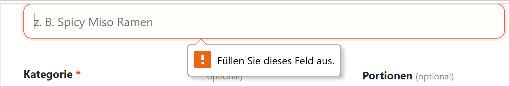
- **Zusammenfassung der Resultate:** **[EIGENE ERGÄNZUNG: wichtigste Erkenntnisse in 2–4 Sätzen zusammenfassen.]**
- **Abgeleitete Verbesserungen:** **[EIGENE ERGÄNZUNG: nächste Schritte priorisieren und begründen. Bereits umgesetzte Erweiterungen zusätzlich in Kapitel 4 dokumentieren.]**

## 4. Erweiterungen [Optional]
Dokumentiert hier Erweiterungen über den Mindestumfang hinaus. Ordnet jede Erweiterung einem der beiden Unterkapitel zu und beschreibt sie einzeln.

> **Hinweis zur Bewertung:** Nur dokumentierte Erweiterungen werden bewertet. Für nicht dokumentierte Erweiterungen oder Erweiterungen, deren Beschreibung bzw. Nachweise die folgenden Vorgaben nicht erfüllen, werden keine Punkte vergeben.

> **Verbindliche Struktur:** Jede Erweiterung muss vollständig und exakt nach dem Schema des jeweiligen Unterkapitels beschrieben werden. Alle Felder sind mit unveränderten Bezeichnungen und in der vorgegebenen Reihenfolge auszufüllen. Wiederholt das Schema für jede weitere Erweiterung und nummeriert die Einträge fortlaufend (4.1.2, 4.1.3 bzw. 4.2.2, 4.2.3). Zusätzliche Erläuterungen innerhalb der Felder sind möglich.

> **Erforderliche Nachweise:** Fügt zu jeder Erweiterung nach Möglichkeit mindestens einen aussagekräftigen Screenshot mit kurzer Erläuterung ein. Falls ein Screenshot nicht sinnvoll möglich ist, begründet dies kurz im Feld «Nachweise» und gebt einen anderen geeigneten Nachweis an. Bei Erweiterungen mit Code sind zusätzlich die relevanten Codestellen zu referenzieren, beispielsweise durch Links auf Dateien und die betreffenden Funktionen oder Zeilenbereiche.

### 4.1 Software-Erweiterungen
Hierzu gehören zusätzliche Funktionen und technische Verbesserungen am Prototyp.

#### 4.1.1 Benutzeranmeldung und Registrierung
- **Beschreibung & Nutzen:** Benutzer können sich mit einem eindeutigen Benutzernamen anmelden oder registrieren. Die Anmeldung ermöglicht persönliche Funktionen, ohne dass für den Prototyp ein Passwort eingegeben werden muss. Bei bereits vergebenen Namen werden eine Fehlermeldung und ein freier Vorschlag wie «Name2» angezeigt.
- **Abgrenzung zum Mindestumfang:** Der Mindestumfang verlangt keine Benutzerkonten oder Authentifizierung. Die Anmeldung geht deshalb über das rezeptorientierte CRUD hinaus.
- **Umsetzung:** Das gemeinsame Login-/Registrierungsfenster liegt in `src/routes/+layout.svelte`. Die Anmeldung wird serverseitig in `src/routes/+page.server.js` verarbeitet. Benutzerdaten und Sitzungen verwaltet `src/lib/server/auth.js` in den MongoDB-Collections `users` und `sessions`; die Sitzung wird als HttpOnly-Cookie geführt.
- **Nachweise:**
  - **Registrierungsfenster:** zeigt die Auswahl zwischen Anmeldung und Registrierung.

    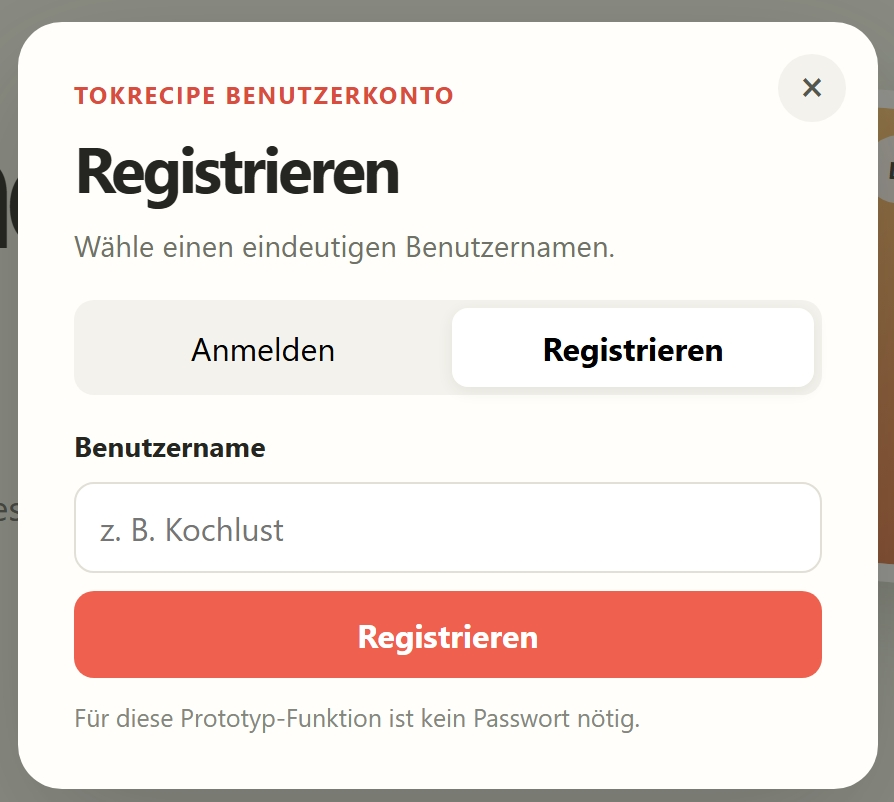
  - **Angemeldeter Zustand:** zeigt den Benutzernamen und den Abmeldebutton.

    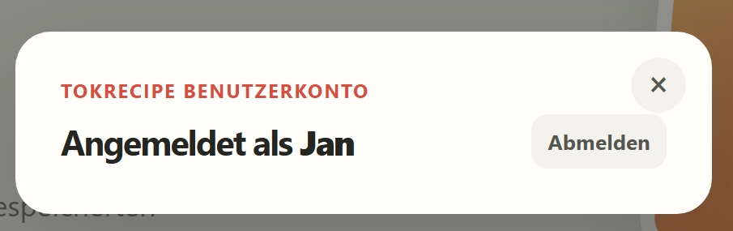
  - **Bereits vergebener Benutzername:** zeigt die Fehlermeldung und den freien Vorschlag «Jan1».

    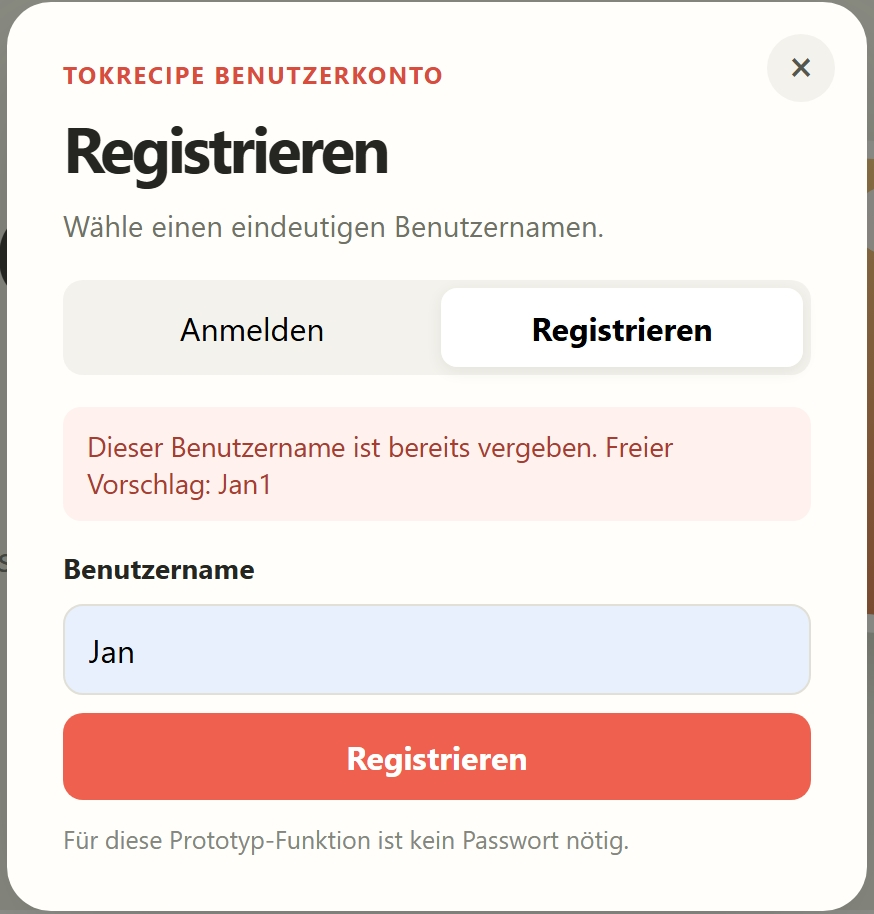
  Relevante Codestellen: `src/routes/+layout.svelte`, `src/routes/+page.server.js`, `src/lib/server/auth.js`.
- **Bezug zur Evaluation:** _[Nach Durchführung der Evaluation ergänzen; falls die Anmeldung nicht aus einer Evaluation abgeleitet wurde, «Nein» angeben.]_

#### 4.1.2 Persönliche gespeicherte Rezepte und Kochstatus
- **Beschreibung & Nutzen:** Angemeldete Benutzer können Rezepte auf der Detailseite speichern und auf der persönlichen Seite «Meine gespeicherten Rezepte» verwalten. Rezepte können als «Bereits gekocht» markiert, wieder geöffnet oder aus der Liste entfernt werden.
- **Abgrenzung zum Mindestumfang:** Eine personalisierte Rezeptliste, der Kochstatus und Login-Abhängigkeit sind für den verbindlichen Rezeptmanager nicht gefordert.
- **Umsetzung:** Die Seite und ihre Aktionen liegen in `src/routes/saved/+page.svelte` und `src/routes/saved/+page.server.js`. Zuordnungen und Kochstatus werden in der MongoDB-Collection `savedRecipes` gespeichert. Auf der Detailseite befinden sich die Aktionen zum Speichern und Entfernen in `src/routes/recipes/[id]/+page.svelte` und `src/routes/recipes/[id]/+page.server.js`.
- **Nachweise:** Der Screenshot zeigt offene und bereits gekochte Rezepte sowie die Aktionen «Bereits gekocht», «Zurück zu offen» und «Entfernen». Der gespeicherte Zustand auf einer Detailseite ist im Rezeptdetail-Screenshot in Kapitel 3.4.1 zu sehen.

  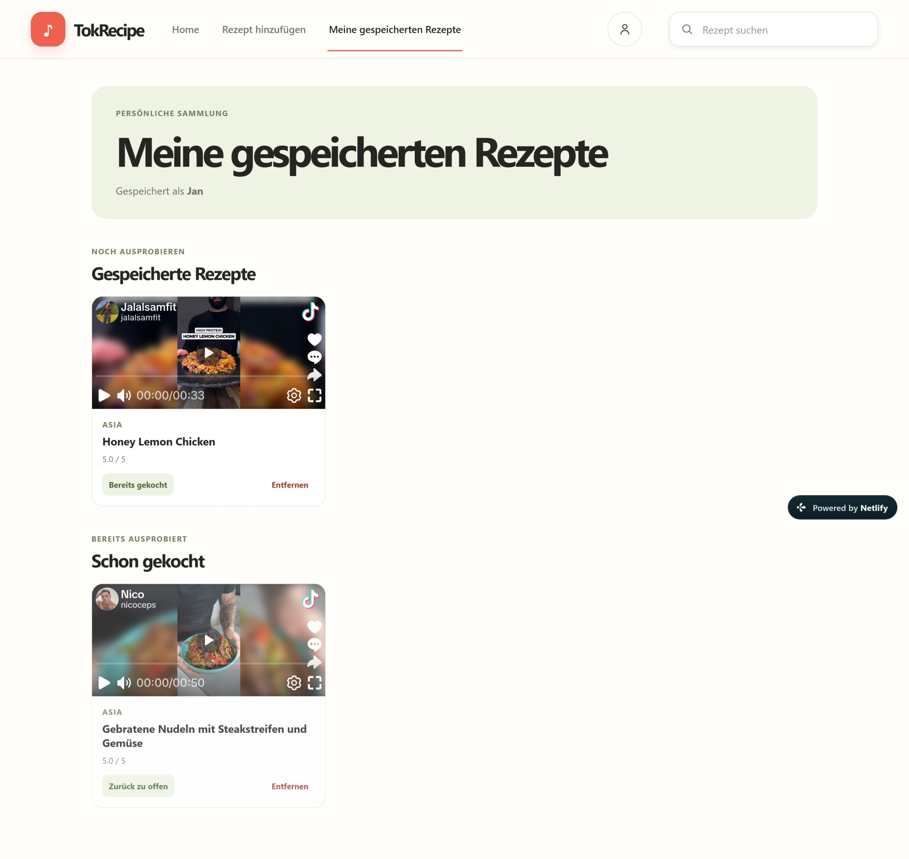

  Relevante Codestellen: `src/routes/saved/+page.svelte`, `src/routes/saved/+page.server.js`, `src/routes/recipes/[id]/+page.server.js`.
- **Bezug zur Evaluation:** _[Nach Durchführung der Evaluation ergänzen; andernfalls «Nein» angeben.]_

#### 4.1.3 Wiederholte Bewertungen und Durchschnittsanzeige
- **Beschreibung & Nutzen:** Ein Rezept kann nach erneutem Kochen nochmals bewertet werden. Dashboard und Detailansicht zeigen den Durchschnitt aller abgegebenen Bewertungen; die Detailansicht nennt zusätzlich die Anzahl der Bewertungen.
- **Abgrenzung zum Mindestumfang:** Mehrfachbewertung und Durchschnittsberechnung gehen über eine einmalige oder rein statische Bewertung hinaus.
- **Umsetzung:** Die Bewertungsaktion liegt in `src/routes/recipes/[id]/+page.server.js`, die Berechnung in `src/lib/server/recipe-rating.js`. Einzelbewertungen werden in der Liste `ratings` gespeichert. Bestehende Einzelbewertungen älterer Rezepte werden unterstützt und auf der Detailseite sowie auf dem Dashboard angezeigt.
- **Nachweise:** Das [Rezeptdetail](./docs/screenshots/recipe-detail.jpeg) zeigt das Bewertungsformular sowie den Durchschnitt und die Anzahl der Bewertungen. Das [Dashboard](./docs/screenshots/dashboard.jpeg) zeigt Bewertungen auf Rezeptkarten. Der folgende Screenshot belegt das Erfolgsfeedback nach dem Bewerten sowie den aktualisierten Durchschnitt.

  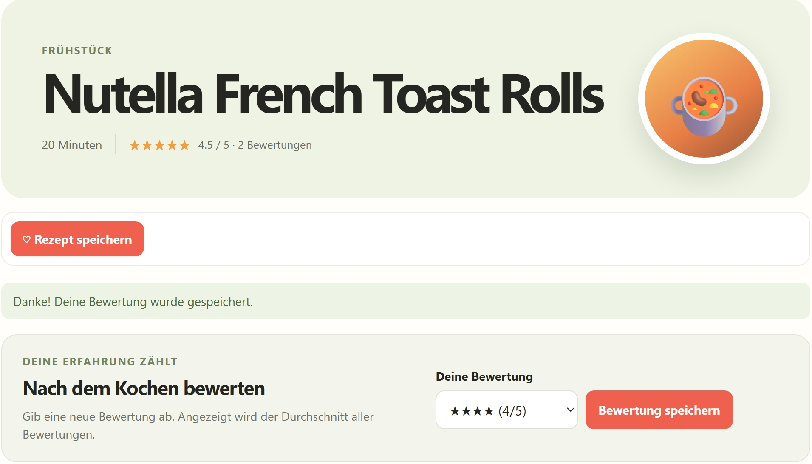

  Relevante Codestellen: `src/routes/recipes/[id]/+page.svelte`, `src/routes/+page.svelte`, `src/routes/recipes/[id]/+page.server.js`, `src/lib/server/recipe-rating.js`.
- **Bezug zur Evaluation:** _[Nach Durchführung der Evaluation ergänzen; andernfalls «Nein» angeben.]_

#### 4.1.4 Eingebettete TikTok-Videos und Vorschauen
- **Beschreibung & Nutzen:** Gespeicherte TikTok-Beiträge können direkt auf der Rezeptdetailseite abgespielt und auf dem Dashboard als lazy-geladene Vorschau angezeigt werden.
- **Abgrenzung zum Mindestumfang:** Der Mindestumfang verlangt einen TikTok-Link, aber keine eingebettete Playeranzeige oder Dashboard-Vorschau.
- **Umsetzung:** Die Video-ID wird aus dem Link extrahiert oder über TikToks oEmbed-Schnittstelle aufgelöst. Die Einbettung liegt in `src/routes/+page.svelte` und `src/routes/recipes/[id]/+page.svelte`; die Auflösung in `src/lib/server/tiktok.js`.
- **Nachweise:** Die [Dashboard-Ansicht](./docs/screenshots/dashboard.jpeg) zeigt eingebettete TikTok-Vorschauen in den Rezeptkarten; der [Rezeptdetail-Screenshot](./docs/screenshots/recipe-detail.jpeg) zeigt den Player beim vollständigen Rezept. Relevante Codestellen: `src/lib/server/tiktok.js`, `src/routes/+page.svelte`, `src/routes/recipes/[id]/+page.svelte`. Originallinks werden pro Rezept gespeichert.
- **Bezug zur Evaluation:** _[Nach Durchführung der Evaluation ergänzen; andernfalls «Nein» angeben.]_

#### 4.1.5 Passwortgeschütztes Löschen und erweiterte Erfassung
- **Beschreibung & Nutzen:** Das Löschen eines Rezepts ist über einen sichtbaren Button und eine Admin-Passwortabfrage geschützt. Die Erfassung bietet zusätzlich optional wählbare Portionen, optionalen Zubereitungstext und die Kategorien Mexican und Frühstück.
- **Abgrenzung zum Mindestumfang:** Die Grundfunktion «Rezept löschen» ist verbindlich; der zusätzliche Adminschutz geht darüber hinaus. Portionen, optionaler Zubereitungstext und zusätzliche Kategorien sind ebenfalls Erweiterungen.
- **Umsetzung:** Die Löschprüfung erfolgt serverseitig in `src/routes/recipes/[id]/+page.server.js` über `ADMIN_DELETE_PASSWORD`. Die Eingabemaske liegt in `src/routes/recipes/[id]/+page.svelte`. Erfassung und Validierung liegen in `src/routes/recipes/new/+page.svelte` und `src/lib/server/recipe-form.js`.
- **Nachweise:** Der Schutzdialog ist unten dargestellt; ein Passwort ist nicht sichtbar. Die optionalen Portionen und Zubereitungsangaben sind im Erfassungsformular in Kapitel 3.4.1 dargestellt.

  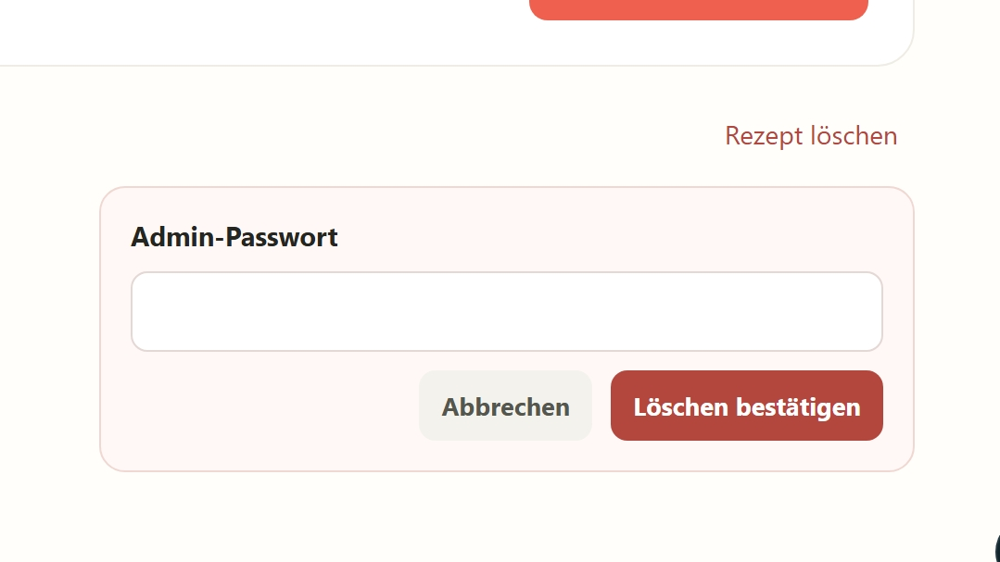

  Relevante Codestellen: `src/routes/recipes/[id]/+page.svelte`, `src/routes/recipes/[id]/+page.server.js`, `src/routes/recipes/new/+page.svelte`, `src/lib/server/recipe-form.js`.
- **Bezug zur Evaluation:** _[Nach Durchführung der Evaluation ergänzen; andernfalls «Nein» angeben.]_

### 4.2 Weitere Erweiterungen
Hierzu gehören beispielsweise zusätzliche Methoden, Planungs- und Analyseartefakte, Verbesserungen der Projektorganisation oder Anpassungen eines KI-Agenten-Workflows.

#### 4.2.1 [Titel der Erweiterung]
- **Beschreibung & Nutzen:** _[Was wurde zusätzlich erarbeitet oder verbessert und welchen Mehrwert bietet es?]_
- **Abgrenzung zum Mindestumfang:** _[Was geht konkret über die verbindlichen Anforderungen hinaus?]_
- **Umsetzung:** _[Wie wurde vorgegangen und was ist das Ergebnis?]_
- **Nachweise:** _[Screenshot(s) mit Erläuterung; Links auf Artefakte, Konfigurationen oder andere Ergebnisse; bei Code zusätzlich Referenzen auf die relevanten Codestellen]_
- **Bezug zur Evaluation:** _[Wurde die Erweiterung aus der Evaluation abgeleitet? Falls ja: auf die betreffende Beobachtung bzw. das Issue verweisen. Andernfalls: «Nein».]_

## 5. Projektorganisation [Optional]

> **Hinweis:** Verbesserungen der Projektorganisation, für die Erweiterungspunkte beansprucht werden, müssen nach dem Schema in Kap. 4.2 dokumentiert werden. Verweist dort bei Bedarf auf die Beschreibung in diesem Kapitel, um Wiederholungen zu vermeiden.

Beispiele:
- **Repository & Struktur:** Repository-Link siehe [Projektübersicht](#projektübersicht--zugänge). Die Anwendung liegt direkt im Repository-Stammverzeichnis; `src/routes/` enthält die Routen und `src/lib/server/` die serverseitigen Hilfsmodule.
- **Vorgehen:** Die Seite wurde schrittweise anhand des Mockups aufgebaut. Zuerst wurden die Grundfunktionen und Hauptworkflows umgesetzt; anschliessend kamen spontan entstandene Ideen und Ergänzungen dazu. Nach jeder neuen Funktion wurde der zugehörige Workflow getestet, um Probleme und Bugs zu finden. Erkannte Fehler wurden fortlaufend zu beheben versucht.
- **Issue-Management:** Es wurden keine GitHub-Issues verwendet.
- **Commit- und Push-Praxis:** Nach grösseren Änderungen, Korrekturen und Feature-Ergänzungen wurden Commits erstellt und zum GitHub-Repository gepusht. Bei längeren Pausen erfolgten teilweise auch Zwischenstands-Pushes, damit der Arbeitsstand nicht nur lokal gespeichert war.

## 6. KI-Deklaration
Die folgende Deklaration ist verpflichtend und beschreibt den Einsatz von KI im Projekt.

> **Hinweis:** Dokumentiert den KI-Einsatz im gesamten Projekt, einschliesslich der Implementierung und eines allfälligen Einsatzes von KI-Agenten (Agentic Coding). Beschreibt die tatsächlich praktizierte Arbeitsweise. Falls keine KI eingesetzt wurde, gebt dies ausdrücklich an; die Unterkapitel 6.1–6.3 können dann entfallen.

### 6.1 KI-Tools
- **Eingesetzte Tools**: Google Gemini, einschließlich Gemini Notebook/NotebookLM auf Basis der Modulunterlagen; GitHub Copilot in Visual Studio Code; Figma Make.
- **Modelle und Versionen:**
- Gemini Pro 3.1
- Gemini Neon (4)
- Gemini Notebook (Notebook mit Vorlesungsmaterial als Grundlage verknüpft mit Gemini Pro und Neon, gearbeitet in Gemini Pro und Neon)
- Copilot Fusion (in VS Studio) wählte passendes Modell automatisch
-Figma Make
- **Zweck & Umfang**: Google Gemini unterstützte die Ideenfindung, die Problemraumanalyse, die Nutzerzentrierung, die Konzeption, die technische Machbarkeitseinschätzung, die Projektreflexion und die Qualitätssicherung. Figma Make wurde zur KI-unterstützten Überarbeitung des ursprünglichen Mockups verwendet. GitHub Copilot unterstützte die Umsetzung des SvelteKit-Prototyps, die MongoDB-Anbindung, Formularvalidierung, Gestaltung und Dokumentation.
- **Eigene Leistung (Abgrenzung):** Projektidee, Problemraumanalyse, Personas, Papier-Skizze und ursprüngliches klickbares Figma-Mockup stammen vom Studierenden. Die von Google Gemini vorgeschlagenen Formulierungen, HMW-Fragen, Personas, Workflows und technischen Optionen sowie die Vorschläge von GitHub Copilot und Figma Make wurden kritisch geprüft, auf die eigenen Anforderungen und Modulvorgaben angepasst und selbstständig weiterverarbeitet. Sämtliche Architekturentscheide, Code-Anpassungen, Tests, Dokumentation und rechtlichen Prüfungen wurden eigenverantwortlich durchgeführt und validiert.

### 6.2 Vorgehen mit KI
- **Arbeitsablauf & Aufgabenverteilung:** Google Gemini wurde über mehrere Projektphasen eingesetzt. Bei der Ideenfindung und Problemraumanalyse unterstützte es mit Brainstorming, Zielgruppenformulierungen und *How Might We*-Fragen. Für Nutzerzentrierung und Konzeption wurden die Personas Lisa, Kevin und Sarah sowie eine User Journey Map für den SOLL-Zustand zu Entdecken, Speichern, Auswählen und Nachkochen strukturiert. Eine Handskizze diente als Grundlage für einen Prompt zur Strukturierung der drei Hauptansichten Dashboard, Erfassungsformular und Detailansicht. Das ursprüngliche klickbare Figma-Mockup wurde gemäss Übungsvorgabe manuell ohne KI-UI-Generator erstellt und anschliessend mit Figma Make KI-unterstützt überarbeitet. Copilot wurde danach schrittweise für Implementierung und Dokumentation eingesetzt.
- **Prompt-Vorgehen & Kontext:** Anforderungen, Zielgruppen, Workflows, Handskizzen, Mockup-Links und Modulvorgaben wurden als Kontext bereitgestellt. Gemini wurde für strukturiertes Brainstorming, technische Machbarkeitseinschätzungen und einen einheitlichen VS-Code-Kontext-Prompt verwendet. Die Vorschläge wurden schrittweise auf den vereinbarten Umfang begrenzt und auf die eigenen Anforderungen zugeschnitten.
- **Konfiguration & Werkzeuge:** Google Gemini und Gemini Notebook/NotebookLM wurden auf Basis der Modulunterlagen eingesetzt. Figma Make unterstützte die Mockup-Überarbeitung. MongoDB-Verbindungsparameter werden lokal über die ignorierte `.env`-Datei bereitgestellt; tatsächliche Zugangsdaten gehören nicht ins Repository. Für GitHub Copilot liegt `.github/copilot-instructions.md` im Repository-Stammverzeichnis. Sie beschreibt Projektstruktur, verfügbare Befehle, Architektur, Repository-Konventionen und wichtige Sicherheits- und Dokumentationshinweise. Zudem wurde festgelegt, dass das README.md Dokument bei Codeanpassungen automatisch bei Bedarf ergänzt werden soll.
- **Prüfung & Überarbeitung:** Bei der technischen Konzeption wurde die Machbarkeit unter anderem für Routing, `load`-Funktionen, Form Actions und MongoDB-Anbindung geprüft. Es wurde bewusst auf automatisches TikTok-Web-Scraping verzichtet und stattdessen der offizielle Embed Player beziehungsweise ein externes Öffnen des Originalvideos verwendet. Der Produktions-Build wurde ausgeführt; die MongoDB-Atlas-Verbindung funktioniert. Die zentralen Workflows wurden mehrfach manuell durchgespielt: Rezepte ansehen, hinzufügen und bearbeiten, das Zufallsrezept aufrufen, Bewertungen abgeben, Rezepte passwortgeschützt löschen sowie Anmeldung und Verwaltung gespeicherter Rezepte. Bei der Registrierung mit einem bereits verwendeten Benutzernamen wurden die Fehlermeldung und der Vorschlag eines freien Namens geprüft. Fehlende Eingaben wurden ebenfalls getestet; für Pflichtfelder zeigt das Formular Fehlermeldungen an.

  Beim Testen wurde ein Fehler im Anmeldefenster entdeckt: Auch nach erfolgreicher Anmeldung öffnete ein Klick auf das Login-Symbol erneut die Anmeldemaske. Dieses Verhalten wurde korrigiert, sodass das Fenster im angemeldeten Zustand die Benutzeraktionen anzeigt. Bei der Sterneanzeige wurde ausserdem festgestellt, dass ab einem Durchschnitt von 4,5 von 5 bereits fünf Sterne gefüllt dargestellt werden. Der Zahlenwert zeigt weiterhin den Durchschnitt; die Sterne selbst werden auf ganze Sterne gerundet und bilden den Wert deshalb nicht exakt ab. Beim Rezeptformular wurde entschieden, nur die wesentlichen Rezeptangaben verpflichtend zu machen. Angaben wie Zubereitungszeit, Portionen und schriftliche Anleitung sind optional; fehlt eine Anleitung, verweist die Detailseite auf das eingebettete TikTok-Video als Kochhilfe. Das erleichtert das Erfassen, ohne die Pflichtangaben für ein speicherbares Rezept aufzugeben. Ende-zu-Ende-Tests werden fortlaufend durchgeführt. Die Player-Anzeige hängt zusätzlich von TikTok und der Verfügbarkeit des jeweiligen Videos ab. Sämtliche KI-Ergebnisse werden vor der Abgabe vom Studierenden geprüft und angepasst.

### 6.3 Reflexion
- **Nutzen:** Google Gemini half insbesondere beim schnellen Strukturieren von Problemraum, Zielgruppen, HMW-Fragen, Personas, Workflows und technischen Alternativen. NotebookLM ermöglichte den thematischen Abgleich mit den Modulunterlagen. Figma Make beschleunigte die Überarbeitung des visuellen Konzepts, GitHub Copilot unterstützte repetitive Implementierungs-, Validierungs- und Dokumentationsaufgaben.
- **Grenzen:** Generierte Inhalte waren nicht automatisch inhaltlich, technisch oder rechtlich korrekt. Beispielsweise mussten vorgeschlagene Textformulierungen, Persona-Annahmen, Schnittstellen, Datenstrukturen und UI-Lösungen mit dem eigenen Projekt, den Modulanforderungen und der tatsächlich verfügbaren Technik abgeglichen werden. Die Authentifizierung mit Benutzername ohne Passwort ist als Prototyp-Lösung bewusst vereinfacht.
- **Risiken/Qualitätssicherung:** Risiken lagen in inhaltlichen Halluzinationen, veralteten API-Vorschlägen, unvollständigen Tests, fehlenden Nachweisen, Urheberrechtsfragen und einer zu breiten oder unsicheren Implementierung. Ein konkreter UI-Fehler zeigte den Wert wiederholter Workflow-Tests: Nach erfolgreicher Anmeldung öffnete ein Klick auf das Login-Symbol weiterhin die Anmeldemaske statt der Benutzeraktionen. Der Fehler wurde beim manuellen Durchspielen entdeckt, korrigiert und erneut geprüft. Dadurch wurde nicht nur die Anmeldung selbst, sondern auch der Zustand der Oberfläche danach überprüft. Weitere Qualitätssicherungsmassnahmen waren die Einbettung über die offizielle TikTok-Schnittstelle, serverseitige Validierung, private Umgebungsvariablen, der Abgleich mit den Bewertungskriterien und Produktions-Build-Prüfungen.
- **Verantwortung:** Sämtliche Architekturentscheidungen, Code-Anpassungen, MongoDB-Konfigurationen, Tests, Dokumentation und rechtliche Prüfungen wurden eigenverantwortlich durchgeführt und validiert. Alle KI-generierten Vorschläge blieben Vorschläge und wurden nicht ungeprüft übernommen.

## 7. Anhang [Optional]

> **Hinweis zu Quellen und Urheberrecht:** Bei Verwendung fremder Inhalte (z. B. Code, Texte, Bilder, Icons, Vorlagen oder Modelle) sind die Quellen und die geltenden Lizenzen bzw. Nutzungsbedingungen anzugeben und einzuhalten. Diese Angaben sind verpflichtend, auch wenn der Anhang weggelassen wird. Sie können alternativ an den betreffenden Stellen der Dokumentation oder in einer verlinkten Quellenübersicht im Repository stehen. Erforderliche Hinweise direkt im Code oder bei verwendeten Inhalten bleiben zusätzlich bestehen.

Beispiele:
- **Quellen:** Die TikTok-Videos werden über den [offiziellen TikTok Embed Player](https://developers.tiktok.com/docs/en/embed-player) eingebettet und nicht lokal kopiert. Der Original-Link bleibt pro Rezept gespeichert und ist auf der jeweiligen Detailseite erreichbar. Für Videos, die in Screenshots oder im Walkthrough konkret gezeigt werden, Creator/Account und Original-Link ergänzen; Nutzungsbedingungen der Plattform und Rechte der Urheber beachten.
- **Testskript & Materialien:** **[EIGENE ERGÄNZUNG: Link oder Dateipfad eintragen, falls vorhanden.]**
- **Rohdaten/Auswertung:** **[EIGENE ERGÄNZUNG: Link oder Dateipfad eintragen, falls vorhanden.]**
